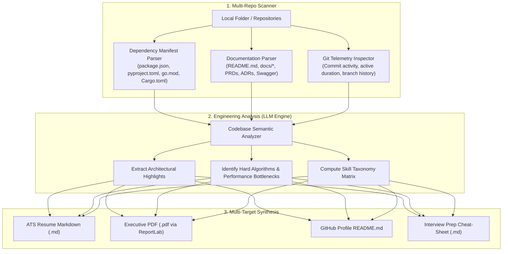

# ⚡ Code My Resume (CMR)

> **Don't write your resume. Let your code write it for you.**

[](https://opensource.org/licenses/MIT)
[](https://python.org)
[](https://github.com/skr2270/CodeMyResume)
[](#)

**Code My Resume (CMR)** is an automated developer intelligence platform and CLI tool that scans your local project directories, reads your architecture specs, `README.md` files, PRDs, dependency manifests, and git telemetry, and compiles a battle-tested, ATS-compliant engineering resume and GitHub profile.

---

## 🎯 The Problem

Developers build extraordinary systems:
* Distributed microservices with event-driven BullMQ queues.
* Low-latency computer vision pipelines running inside Web Workers.
* Complex database schema migrations and soft-deletion architectures.
* Headless mobile commerce apps with custom state machines.

Yet, when updating their resumes, most engineers experience **the blank page problem** and write generic summaries like:
> *"Worked as a full stack developer using React and Node.js."*

Existing resume builders only format templates or ask for manual data entry. **Code My Resume connects directly to ground truth: your actual code, documentation, and commit history.**

---

## 🚀 Key Features

* 🔍 **Multi-Repo Auto-Discovery:** Point CMR to your `~/Projects` or `C:\Projects\` directory. It recursively identifies all distinct repositories while safely ignoring noise (`node_modules`, `.venv`, `.git`, `build`, `dist`).
* 📦 **Manifest & Dependency Intelligence:** Automatically extracts languages, frameworks, and tools by parsing:
  * JavaScript/TypeScript (`package.json`, `pnpm-workspace.yaml`, `turbo.json`)
  * Python (`pyproject.toml`, `requirements.txt`, `Pipfile`)
  * Go (`go.mod`), Rust (`Cargo.toml`), PHP (`composer.json`)
  * Infrastructure (`Dockerfile`, `docker-compose.yml`, Helm charts)
* 📑 **Deep Documentation Extraction:** Ingests `README.md`, `docs/*.md`, Architecture Decision Records (ADRs), Product Requirement Documents (PRDs), and Swagger/OpenAPI schemas.
* 🤖 **Google XYZ-Formula Bullet Generation:** Synthesizes complex engineering accomplishments using the proven formula:  
  $$\text{Accomplished [X]} \text{ as measured by [Y]} \text{ by doing [Z]}$$
* 🛡️ **Anti-Hallucination & Ground-Truth Enforcement:** Never fabricates libraries or metrics. Everything in the resume traces directly back to code found on disk.
* 📄 **Multi-Format Export Engine:**
  * **ATS-Optimized Markdown:** Plain text structured for modern Applicant Tracking Systems.
  * **Publication-Quality PDF:** Built via ReportLab / RenderCV with strict 1-page or 2-page page-budget enforcement.
  * **GitHub Profile `README.md`:** Aesthetic markdown with Shields.io badges, skill taxonomy matrix, and featured project cards.
* 🔒 **Local & Privacy First:** Zero proprietary code leaves your computer. Runs with local LLMs (Ollama) or private API keys (Gemini, Claude, OpenAI).

---

## 🏗️ Architecture Overview



---

## ⚡ Quick Start

### 1. Installation

```bash
# Clone the repository
git clone https://github.com/skr2270/CodeMyResume.git
cd CodeMyResume

# Set up virtual environment
python -m venv .venv
source .venv/bin/activate  # On Windows: .venv\Scripts\activate

# Install dependencies
pip install -r requirements.txt
```

### 2. Configure Environment

Create a `.env` file with your preferred LLM provider:

```env
# Choose your provider: gemini | ollama | openai | anthropic
CMR_LLM_PROVIDER=gemini
GEMINI_API_KEY=your_gemini_api_key_here
```

### 3. Run the CLI

Scan your projects directory and generate your resume:

```bash
# Scan a directory containing multiple projects
cmr scan --path "C:\Saikumar\Projects"

# Output resume in PDF, Markdown, and GitHub README formats
cmr generate --output "./output" --format all
```

---

## 📂 Documentation Directory

Detailed specifications and architectural guides are available in [`docs/`](./docs/):

| Document | Description |
| :--- | :--- |
| **[`docs/ARCHITECTURE.md`](./docs/ARCHITECTURE.md)** | End-to-end system design, scanner pipeline, and data schemas |
| **[`docs/PARSERS_SPEC.md`](./docs/PARSERS_SPEC.md)** | Manifest extraction logic across 6 languages and config formats |
| **[`docs/PROMPT_ENGINEERING.md`](./docs/PROMPT_ENGINEERING.md)** | Few-shot prompts, Google XYZ bullet rules, and anti-hallucination guards |
| **[`docs/ROADMAP.md`](./docs/ROADMAP.md)** | Phased engineering milestones (CLI, Web UI, GitHub Action) |

---

## 🤝 Contributing

Contributions are welcome! Whether it's adding a new language manifest parser, improving PDF templates, or refining LLM prompts:

1. Fork the repository
2. Create your feature branch (`git checkout -b feature/rust-cargo-parser`)
3. Commit your changes (`git commit -m 'Add Cargo.lock and Cargo.toml parser'`)
4. Push to the branch (`git push origin feature/rust-cargo-parser`)
5. Open a Pull Request

---

## 📜 License

Distributed under the MIT License. See `LICENSE` for more information.
