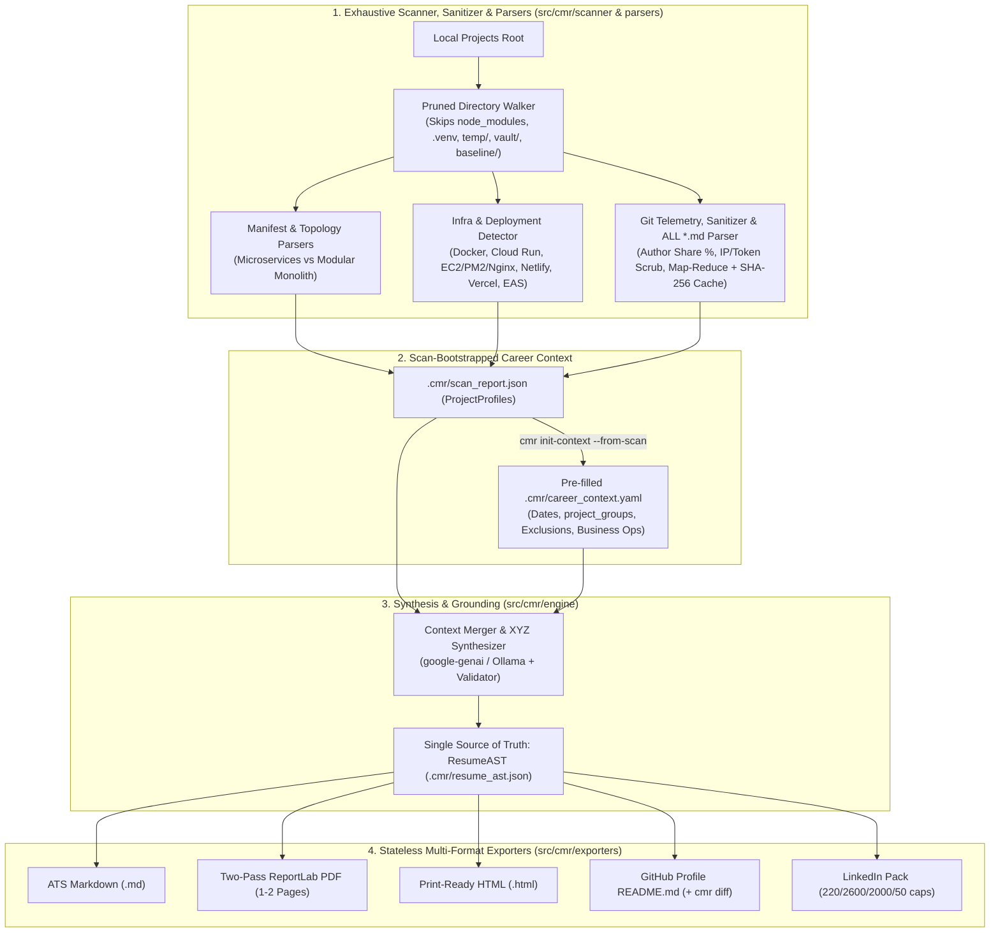

# ⚡ Code My Resume (CMR)

> **Don't write your resume. Let your code write it for you.**

[](https://opensource.org/licenses/MIT)
[](https://python.org)
[](./docs/ROADMAP.md)
[](#)

**Code My Resume (CMR)** is a ground-truth developer intelligence CLI that scans your local project directories, verifies code topology, parses manifests, documentation, deployment configs, and git authorship telemetry, merges them with your career timeline (`career_context.yaml`), and compiles a consistent **Resume AST** into ATS Markdown, publication-grade PDFs, and GitHub Profile READMEs.

---

## 🎯 The Problem

Engineers build extraordinary systems—distributed microservices, modular GraphQL platforms, mobile commerce ecosystems, automated document pipelines, and low-latency computer vision engines. Yet when updating resumes or using generic AI tools, five things consistently go wrong:

1. **The Blank Page Problem:** Years of deep engineering get compressed into *"Worked on React and Node.js."*
2. **Architecture Misclassification:** Reading a README that mentions "21 services" tricks generic LLMs into calling a Domain-Driven Modular Monolith *"21 microservices."*
3. **Changelog Recency Bias:** Over-indexing on recent audit reports or changelogs makes a Lead Full-Stack Architect look like they only ran audits, erasing frontend, mobile, and deployment ownership.
4. **Timeline, Fork & Legacy Drift:** Forked repositories inject unused languages (e.g., Go), stale claims leak from older resumes (`Keycloak`, `Kubernetes`), frameworks get extrapolated (`WebGL` on a `Canvas 2D` app), and missing employment context mixes up project dates or drops non-code leadership (vendor integrations, staff training, Google Merchant/marketing ops).
5. **Broken PDF Pagination:** Naive PDF generators insert hardcoded `PageBreak()` calls or tiny `7.5pt` fonts, creating huge dead whitespace at the bottom of Page 1 or half-empty pages.

**Code My Resume solves these at the architectural level by separating verified structural code facts from prose, anchoring everything to a Single Source of Truth (`ResumeAST`), and calibrating page density automatically.**

---

## 🚀 Key Architecture & Capabilities

* 🔍 **Fast Pruned Multi-Repo Discovery (`scanner/walker.py`):** Uses top-down pruning (`os.walk` in-place directory skipping) to bypass `node_modules`, `.venv`, `.git`, `build`, `dist`, `.gradle`, and scratch/archive folders (`temp/`, `vault/`, `baseline/`, `appstore-screenshots/`, `.agents/`) without traversing millions of dependency files.
* 🏗️ **Structural Topology Detection (`parsers/topology_detector.py`):** Inspects code layout before trusting prose—distinguishing **Distributed Microservices** (multiple `main.ts` / `apps/*` / `nx.json` nodes) from **Domain-Driven Modular Monoliths** (single entrypoint + `app.module.ts` feature modules) and **Polyglot Workspaces** (backend + web + admin + mobile).
* ☁️ **Deployment & Infra Detector (`parsers/infra_detector.py`):** Automatically surfaces production DevOps ownership from `Dockerfile`, `docker-compose*.yml`, Google Cloud Run configs, Netlify/Vercel manifests, EAS Build configs, `ecosystem.config.*` (PM2), and Nginx TLS configs.
* 📦 **Manifest & Author-Verified Telemetry (`parsers/manifest_parser.py`, `git_parser.py`):** Parses `package.json`, `pyproject.toml` (`tomllib`/`tomli`), `requirements.txt`, `go.mod`, `Cargo.toml`, and `composer.json`, cross-checked against `git shortlog` author attribution so forked repos never pollute your core tech stack.
* 📑 **Full-File `.md` Discovery, Cache & Sanitizer (`parsers/doc_parser.py`, `sanitizer.py`):** Scans **100% of all `*.md` files** across every project, performs regex signal extraction + Map-Reduce heading chunking (with `.cmr/cache/` SHA-256 incremental caching), scrubs server IPs/API tokens/JWTs before any cloud LLM call, and separates *Core Architecture Docs* from *Changelogs/Audits*.
* 🧭 **Scan-Bootstrapped Career Context (`career_context.yaml`):** Run `cmr scan` first into `.cmr/scan_report.json`, then `cmr init-context --from-scan` to pre-fill `career_context.yaml` where you confirm employment dates, group client repos (`project_groups`), hide/anonymize employers, and add non-code business leadership (POS/fintech integrations, staff training, marketing ops).
* 🛡️ **Single Source of Truth (`ResumeAST` $\rightarrow$ Exporters) & Density Calibration:** Synthesizes a validated Pydantic AST (`.cmr/resume_ast.json`) using Google's XYZ formula (enforcing topology, legacy-claim, framework, and secret-leak guards) and renders synchronized outputs:
  * **ATS Markdown** (`.md`)
  * **Two-Pass Balanced PDF** (`.pdf` via ReportLab with TTF Unicode glyphs, clickable links, `KeepTogether`/`keepWithNext`, zero manual `PageBreak()`, and `pdfplumber` bounds verification targeting $\ge 88\%$ Page 1 fill)
  * **Print-Ready HTML** (`.html` continuously flowing with `@page` & `break-after: avoid` rules)
  * **GitHub Profile** (`README.md`, with `cmr diff` preview against live profiles)
  * **LinkedIn Profile Pack** (`LinkedIn_Profile_Pack.md` enforcing exact `220` / `2,600` / `2,000` / `50` platform limits)
* 🔒 **Local & Privacy First:** Proprietary code and `.env` secrets stay on disk. Supports 100% offline **Ollama** inference or private API keys via the unified **`google-genai`**, OpenAI, or Anthropic SDKs.

---

## 🏗️ System Pipeline



---

## ⚡ Quick Start (Planned v0.1.0 Workflow)

> [!NOTE]
> `CodeMyResume` is currently in active Phase 1 development (`src/cmr/`). Follow [`docs/ROADMAP.md`](./docs/ROADMAP.md) for live module implementation status.

### 1. Installation

```bash
# Clone the repository
git clone https://github.com/skr2270/CodeMyResume.git
cd CodeMyResume

# Set up virtual environment
python -m venv .venv
source .venv/bin/activate  # On Windows: .venv\Scripts\activate

# Install in editable mode with dev test dependencies (once src/cmr modules are populated)
pip install -e ".[dev]"
```

### 2. Configure Environment & Scan Local Projects First

Create a `.env` file with your preferred LLM provider:

```env
# Choose your provider: gemini | ollama | openai | anthropic
CMR_LLM_PROVIDER=gemini
GEMINI_API_KEY=your_gemini_api_key_here
```

Run `cmr scan` **first** (defaults to `.cmr/` state storage so you don't need to juggle file paths):

```bash
# Step 1: Scan all projects and *.md files into .cmr/scan_report.json
cmr scan "C:\Saikumar\Projects"

# Step 2: Bootstrap a pre-populated .cmr/career_context.yaml from the scan
cmr init-context --from-scan
```

Review `.cmr/career_context.yaml` to confirm employment anchor dates, configure `project_groups`, hide/anonymize any employers, and add non-code business impact (e.g., POS/fintech integrations, staff training, marketing operations).

### 3. Generate & Preview Synchronized Outputs

```bash
# Step 3: Merge scan + context -> .cmr/resume_ast.json -> all formats
cmr generate --output "./output" --format pdf,md,html,github,linkedin

# Optional: Preview diff before overwriting an existing GitHub Profile README
cmr diff --target "../skr2270/README.md"
```

---

## 📂 Documentation Directory

All technical specifications, schemas, and engineering guidelines live in [`docs/`](./docs/):

| Document | Description |
| :--- | :--- |
| **[`docs/ARCHITECTURE.md`](./docs/ARCHITECTURE.md)** | `src/cmr/` package layout, Pydantic schemas (`ProjectProfile`, `CareerContext`, `ResumeAST`), and stateless exporters |
| **[`docs/PARSERS_SPEC.md`](./docs/PARSERS_SPEC.md)** | Manifest rules (`tomli`/`tomllib`), topology classifier, infra detector, anti-recency doc chunking, and git authorship filters |
| **[`docs/PROMPT_ENGINEERING.md`](./docs/PROMPT_ENGINEERING.md)** | Google XYZ-formula prompts, chronology/terminology guardrails, and post-generation ground-truth validation |
| **[`docs/ROADMAP.md`](./docs/ROADMAP.md)** | Honest milestone tracker across Phase 1 (CLI/Parsers) through Phase 4 (GitHub Action) |

---

## 🤝 Contributing

Contributions are welcome! Whether it's implementing a manifest/topology parser, refining ReportLab dynamic pagination, or adding prompt validation rules:

1. Fork the repository
2. Create your feature branch (`git checkout -b feature/topology-detector`)
3. Commit your changes (`git commit -m 'feat: implement NestJS modular monolith topology detector'`)
4. Push to the branch (`git push origin feature/topology-detector`)
5. Open a Pull Request

---

## 📜 License

Distributed under the MIT License. See [`LICENSE`](./LICENSE) for more information.
