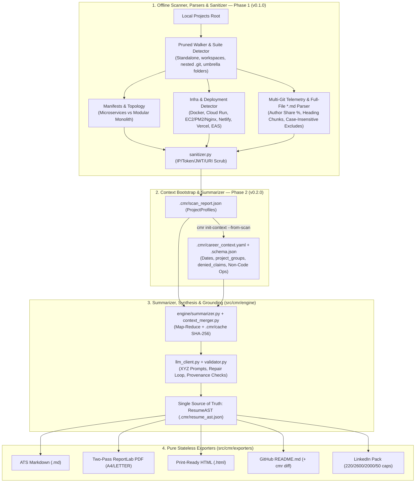

# ⚡ Code My Resume (CMR)

> **Don't write your resume. Let your code write it for you.**

[](https://opensource.org/licenses/MIT)
[](https://python.org)
[](./docs/ROADMAP.md)
[](#)

**Code My Resume (CMR)** is a ground-truth developer intelligence CLI that scans local project directories deterministically offline, verifies code topology, parses manifests, documentation, deployment configs, and multi-repo git authorship telemetry, merges them with your career timeline (`career_context.yaml`), and compiles a validated **Resume AST** into ATS Markdown, publication-grade PDFs, HTML, GitHub Profiles, and LinkedIn Packs.

---

## 🎯 The Problem

Engineers build extraordinary systems—distributed microservices, modular GraphQL platforms, mobile commerce ecosystems, automated document pipelines, and low-latency computer vision engines. Yet when updating resumes or using generic AI tools, five things consistently go wrong:

1. **The Blank Page Problem:** Years of deep engineering get compressed into *"Worked on React and Node.js."*
2. **Architecture Misclassification:** Reading a README that mentions "21 services" tricks generic LLMs into calling a Domain-Driven Modular Monolith *"21 microservices."*
3. **Changelog Recency Bias:** Over-indexing on recent audit reports or changelogs makes a Lead Full-Stack Architect look like they only ran audits, erasing frontend, mobile, and deployment ownership.
4. **Timeline, Fork & Legacy Drift:** Forked repositories inject unused languages (e.g., Go), stale claims leak from older resumes (`Keycloak`, `Kubernetes`), frameworks get extrapolated (`WebGL` on a `Canvas 2D` app), and missing employment context mixes up project dates or drops non-code leadership (vendor integrations, staff training, marketing ops).
5. **Broken PDF Pagination:** Naive PDF generators insert hardcoded `PageBreak()` calls or fixed `7.5pt` layouts, creating dead whitespace at the bottom of Page 1 or wrapping cities onto orphan lines.

**Code My Resume solves these architecturally by separating offline structural code facts from prose, anchoring every bullet with provenance inside `ResumeAST`, and calibrating page density dynamically.**

---

## 🚀 Key Architecture & Capabilities

* 🔍 **Fast Pruned Multi-Repo Discovery (`scanner/walker.py`, `detector.py`):** Uses top-down pruning (`os.walk`) to skip `node_modules`, `.venv`, `.git`, `build`, `dist`, `.gradle`, `.next`, `.expo`, `.turbo`, `target`, and scratch trees (`temp/`, `vault/`, `baseline/`, `appstore-screenshots/`, `.agents/`) while cleanly grouping standalone repos, npm/pnpm `workspaces`, nested-`.git` suites, and multi-platform umbrella folders.
* 🏗️ **Structural Topology Detection (`parsers/topology_detector.py`):** Inspects code layout before trusting prose—distinguishing **Distributed Microservices** (multiple non-test `apps/*/src/main.ts` / modern Nx nodes) from **Domain-Driven Modular Monoliths** (single entrypoint + `app.module.ts` domain modules) and **Polyglot Workspaces**.
* ☁️ **Deployment & Infra Detector (`parsers/infra_detector.py`):** Surfaces production DevOps ownership from `Dockerfile`, `docker-compose*.yml`, Cloud Run configs, Netlify/Vercel manifests, EAS Build configs, Android Gradle R8/NDK configs, `ecosystem.config.*` (PM2), and Nginx TLS configs.
* 📦 **Manifest & Multi-Repo Author Telemetry (`parsers/manifest_parser.py`, `git_parser.py`):** Parses `package.json` (with `workspaces` + `devDependencies`), `pyproject.toml` (`tomllib`/`tomli`), `requirements.txt`, Gradle, Flutter, `go.mod`, `Cargo.toml`, and `composer.json`, cross-checked against aggregated child `.git` authorship so forked repos never pollute your core tech stack.
* 📑 **Offline Full-File `.md` Parser & Mandatory Sanitizer (`parsers/doc_parser.py`, `sanitizer.py`):** Scans **100% of all `*.md` files** (case-insensitive noise filtering + size caps), extracts regex metrics and heading chunks deterministically, and scrubs server IPs (ignoring RFC 1918 and version numbers), API tokens, JWTs, and DB URIs *before* writing `.cmr/scan_report.json` or hitting `.cmr/cache/` / cloud LLMs.
* 🧭 **Scan-Bootstrapped Career Context (`career_context.yaml`):** Run `cmr scan` first (`v0.1.0`), then `cmr init-context --from-scan` (`v0.2.0`) to generate a JSON-schema-validated `.cmr/career_context.yaml` where you confirm employment dates, group client repos (`project_groups`), configure `denied_claims` / excluded employers, and add non-code leadership impact.
* 🛡️ **Single Source of Truth (`ResumeAST` $\rightarrow$ Exporters) & Density Calibration:** Synthesizes a validated Pydantic AST (`.cmr/resume_ast.json`) with per-bullet `source_projects` provenance using Google's XYZ formula and renders synchronized outputs:
  * **ATS Markdown** (`.md`)
  * **Two-Pass Balanced PDF** (`.pdf` via ReportLab on `A4` or `LETTER` with dynamic column headers, bundled TTF Unicode glyphs, clickable links, `KeepTogether`/`keepWithNext`, zero manual `PageBreak()`, and proportional `pdfplumber` verification targeting $\ge 88\%$ Page 1 fill)
  * **Print-Ready HTML** (`.html` continuously flowing with `@page` & `break-after: avoid` rules)
  * **GitHub Profile** (`README.md`, with `cmr diff` preview against live profiles)
  * **LinkedIn Profile Pack** (`LinkedIn_Profile_Pack.md` enforcing exact `220` / `2,600` / `2,000` / `50` platform limits)
* 🔒 **Local & Privacy First:** Zero telemetry; `.env` and keyfiles are blocked from reading. Supports **Ollama** for 100% air-gapped inference alongside **`google-genai`**, OpenAI, and Anthropic SDKs with automatic JSON validation repair retries.

---

## 🏗️ System Pipeline



---

## ⚡ Quick Start (Target v0.1.0–v0.2.0 Workflow)

> [!NOTE]
> `CodeMyResume` is at the completed specification baseline (`docs/`) with Phase 1 (`cmr scan` offline parsers) scheduled next. Follow [`docs/ROADMAP.md`](./docs/ROADMAP.md) for live module status.

### 1. Installation

```bash
# Clone the repository
git clone https://github.com/skr2270/CodeMyResume.git
cd CodeMyResume

# Set up virtual environment
python -m venv .venv
source .venv/bin/activate  # On Windows: .venv\Scripts\activate

# Copy environment & config starters
cp .env.example .env

# Install in editable mode with dev test dependencies (once src/cmr modules are populated)
pip install -e ".[dev]"
```

### 2. Scan Local Projects Offline First (`v0.1.0`)

```bash
# Step 1: Offline scan across all repos and *.md files -> .cmr/scan_report.json
cmr scan "~/Projects" --config config.yaml
```

### 3. Bootstrap Context & Synthesize Outputs (`v0.2.0`)

```bash
# Step 2: Bootstrap a pre-populated .cmr/career_context.yaml from the scan
cmr init-context --from-scan --config config.yaml

# Step 3: Merge scan + context -> .cmr/resume_ast.json -> all formats
cmr generate --config config.yaml --output "./output" --format pdf,md,html,github,linkedin

# Optional: Preview diff before overwriting an existing GitHub Profile README
cmr diff --target "../skr2270/README.md"
```

---

## 📂 Documentation Directory

All technical specifications, templates, and engineering guidelines live in [`docs/`](./docs/) and root config files:

| File | Description |
| :--- | :--- |
| **[`docs/PRD.md`](./docs/PRD.md)** | Product requirements, personas, full CLI contract (`scan`, `init-context`, `generate`, `diff`), exit codes, and schemas |
| **[`docs/ARCHITECTURE.md`](./docs/ARCHITECTURE.md)** | `src/cmr/` package layout, Pydantic schemas (`ProjectProfile`, `CareerContext`, `ResumeAST`), and workspace rules |
| **[`docs/PARSERS_SPEC.md`](./docs/PARSERS_SPEC.md)** | Workspaces-aware manifests, expanded `TAXONOMY_RULES`, Nx/monolith detector, offline full-file `.md` parser, `sanitizer.py`, multi-`.git` telemetry |
| **[`docs/EXPORTERS_SPEC.md`](./docs/EXPORTERS_SPEC.md)** | Exact specs for ATS Markdown, Two-Pass ReportLab PDF (`A4`/`LETTER`), continuous HTML, GitHub Profile + `cmr diff`, LinkedIn Pack |
| **[`docs/PROMPT_ENGINEERING.md`](./docs/PROMPT_ENGINEERING.md)** | Google XYZ-formula prompts, Ollama JSON repair loop, and `validator.py` allowlist/denylist/provenance checks |
| **[`docs/SECURITY.md`](./docs/SECURITY.md)** | Threat boundary, zero-read secret file blocklist, `sanitizer.py` redaction rules, and offline privacy posture |
| **[`docs/TESTING_AND_QA.md`](./docs/TESTING_AND_QA.md)** | Offline test pyramid, real-workspace golden fixtures, proportional `pdfplumber` assertions, and LinkedIn cap gates |
| **[`docs/ROADMAP.md`](./docs/ROADMAP.md)** | Milestone tracker across Phase 1 (`v0.1.0`) through Phase 4 (`v1.0.0`) |
| **[`config.yaml`](./config.yaml)** / **[`career_context.example.yaml`](./career_context.example.yaml)** | Default scanner/PDF/LLM YAML configuration and anonymized career context template |
| **[`CONTRIBUTING.md`](./CONTRIBUTING.md)** / **[`CODE_OF_CONDUCT.md`](./CODE_OF_CONDUCT.md)** | Setup, offline test rules, contribution paths, and Contributor Covenant v2.1 |
| **[`CHANGELOG.md`](./CHANGELOG.md)** | Versioned release and specification history (Keep a Changelog) |

---

## 🤝 Contributing

Contributions are welcome! See **[`CONTRIBUTING.md`](./CONTRIBUTING.md)** and **[`CODE_OF_CONDUCT.md`](./CODE_OF_CONDUCT.md)** before submitting pull requests.

---

## 📜 License

Distributed under the MIT License. See [`LICENSE`](./LICENSE) for more information.
