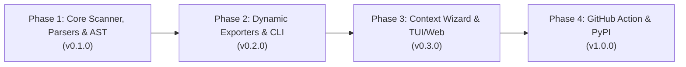

# Engineering Roadmap — Code My Resume (CMR)

This roadmap tracks verified engineering progress across **Code My Resume (CMR)** from architectural specification to v1.0.0 release.

---

## 🗺️ Milestone Overview

---

## Phase 1: Core Scanner, Parsers & Models (v0.1.0) — *In Progress*
- [x] Initial repository scaffolding, MIT License, and `.gitignore` hygiene.
- [x] Clean packaging configuration in `pyproject.toml` & `requirements.txt` (`src`-layout `packages.find`, `google-genai`, `pdfplumber`, `httpx`, Python 3.10 `tomli` marker, and `dev` extras).
- [x] Complete specifications & root docs (`PRD.md`, `ARCHITECTURE.md`, `PARSERS_SPEC.md`, `PROMPT_ENGINEERING.md`, `SECURITY.md`, `TESTING_AND_QA.md`, `CONTRIBUTING.md`, `CHANGELOG.md`).
- [ ] Complete `src/cmr/` module layout (`engine/`, `exporters/`, `tests/`, `config.yaml`, `career_context.example.yaml`) and Pydantic v2 schemas in `src/cmr/models.py` (`ProjectProfile`, `CareerContext` + `project_groups`, `ResumeAST`).
- [ ] `src/cmr/scanner/walker.py` & `detector.py`: Pruned `os.walk` traversal + polyglot workspace grouping.
- [ ] `src/cmr/parsers/manifest_parser.py`: Extractors for `package.json`, `pyproject.toml`, `requirements.txt`, `go.mod`, `Cargo.toml`.
- [ ] `src/cmr/parsers/topology_detector.py`: Structural classifier (Distributed Microservices vs. Modular Monolith).
- [ ] `src/cmr/parsers/infra_detector.py`: Deployment detector (Docker, Cloud Run, EC2/Nginx/PM2, Netlify, Vercel, EAS Build).
- [ ] `src/cmr/parsers/doc_parser.py`, `sanitizer.py` & `git_parser.py`: Full-file `*.md` discovery, Map-Reduce chunking + `.cmr/cache/` SHA-256 caching, pre-LLM IP/secret redaction, and author commit share filtering.
- [ ] CLI Step 1 (`cmr scan`) emitting `.cmr/scan_report.json` + offline unit test suite (`tests/test_scanner.py`, `tests/test_parsers.py`).

---

## Phase 2: Scan-Bootstrapped Context, Synthesis & Stateless Exporters (v0.2.0)
- [ ] `cmr init-context --from-scan`: Pre-populates `.cmr/career_context.yaml` using discovered project profiles, git date ranges, `project_groups`, and `candidate_org_hints`.
- [ ] `src/cmr/engine/context_merger.py` & `llm_client.py`: Merge `.cmr/scan_report.json` with `career_context.yaml` and synthesize `ResumeAST` via `google-genai` / Ollama.
- [ ] `src/cmr/engine/validator.py`: Post-generation topology, fork-language, legacy-claim, secret/IP leak, chronology, and metric grounding validation.
- [ ] Stateless exporters driven strictly by `ResumeAST` (`.cmr/resume_ast.json`):
  * `markdown_exporter.py` (ATS-optimized Markdown)
  * `html_exporter.py` (Continuously flowing `@media print` HTML without artificial page splits)
  * `pdf_exporter.py` (Two-pass ReportLab 1/2-page density calibration engine with TTF Unicode glyphs, clickable hyperlinks, `KeepTogether`, `keepWithNext`, zero manual `PageBreak()`, and `pdfplumber` fill-bounds verification)
  * `github_exporter.py` (GitHub Profile `README.md` + `cmr diff` preview against live profile)
  * `linkedin_exporter.py` (LinkedIn Profile Pack enforcing exact 220 / 2,600 / 2,000 / 50 field limits)
- [ ] Optional [RenderCV](https://github.com/rendercv/rendercv) YAML export bridge for LaTeX resumes.

---

## Phase 3: Interactive TUI & Local Web Studio (v0.3.0)
- [ ] Terminal UI (built with [Textual](https://textual.textualize.io/)) for interactively inspecting `scan_report.json`, editing `career_context.yaml` (anonymization, non-code impacts), and toggling project visibility.
- [ ] Local web preview (`cmr web`) displaying side-by-side `ResumeAST` editor and live PDF preview.
- [ ] Multi-persona resume profiles:
  * *Lead Full-Stack Architect / Founding Engineer*
  * *Distributed Systems & Backend Engineer*
  * *Cybersecurity & Platform Reliability Engineer*

---

## Phase 4: GitHub Action & Public Release (v1.0.0)
- [ ] Official GitHub Action (`skr2270/code-my-resume-action`) to refresh GitHub profile READMEs on release tags.
- [ ] Multi-platform Docker image for sandboxed CI runs.
- [ ] Public PyPI release (`pip install code-my-resume`).
