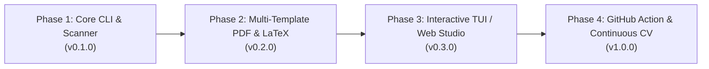

# Engineering Roadmap — Code My Resume (CMR)

This roadmap outlines the phased development and open-source release strategy for **Code My Resume (CMR)**.

---

## 🗺️ Milestone Overview

---

## Phase 1: Core CLI & Scanner (v0.1.0) — *Current Phase*
- [x] Initial architecture and project scaffolding.
- [x] Directory walker with smart pruning (`node_modules`, `.git`, `build` exclusions).
- [ ] Manifest extractors for Node.js (`package.json`) and Python (`pyproject.toml`, `requirements.txt`).
- [ ] Markdown documentation parser for `README.md` and `docs/`.
- [ ] LLM integration for Google XYZ bullet synthesis (Gemini & Ollama local).
- [ ] Basic ATS Markdown export.

---

## Phase 2: Multi-Template PDF & LaTeX Engines (v0.2.0)
- [ ] Native ReportLab PDF generator with strict 1-page and 2-page budget algorithms.
- [ ] Integration with [RenderCV](https://github.com/rendercv/rendercv) for LaTeX compilation.
- [ ] Export directly to HTML with responsive `@media print` formatting.
- [ ] Git history date range extraction (first commit to latest commit auto-dates).

---

## Phase 3: Interactive TUI & Local Web Studio (v0.3.0)
- [ ] Terminal UI (built with [Textual](https://textual.textualize.io/)) for interactive project selection.
- [ ] Toggle inclusion of specific projects or client confidentiality masking (e.g., anonymizing company names for freelance projects).
- [ ] Drag-and-drop local web dashboard (`cmr web`) with live PDF preview.
- [ ] Multi-persona resume generation:
  * *Backend / Distributed Systems Architect*
  * *Full-Stack / Mobile Specialist*
  * *Cybersecurity & Security Engineer*

---

## Phase 4: GitHub Action & Continuous CV (v1.0.0)
- [ ] Official GitHub Action: `skr2270/code-my-resume-action`.
- [ ] Auto-updates your profile `README.md` and rebuilds your resume PDF upon tagging a new release across your repositories.
- [ ] Docker container image for automated cloud runners.
- [ ] Distribution via PyPI (`pip install code-my-resume`) and npm (`npx code-my-resume`).

