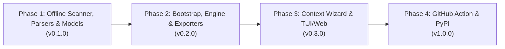

# Engineering Roadmap — Code My Resume (CMR)

This roadmap tracks verified engineering progress across **Code My Resume (CMR)** from architectural specification to v1.0.0 release.

---

## 🗺️ Milestone Overview

---

## Phase 1: Core Offline Scanner, Parsers & Models (`v0.1.0`) — *Spec Complete, Coding Next*
- [x] Initial repository scaffolding, MIT `LICENSE`, `.gitignore`, `.editorconfig`, `.gitattributes`, and `.github/` CI/templates.
- [x] Packaging metadata in `pyproject.toml` & `requirements.txt` (`src`-layout `packages.find`, `package-data`, `google-genai`, `pdfplumber`, `httpx`, Python 3.10 `tomli`, `[dev]` & `[llms]` extras).
- [x] Complete specifications & starter templates (`PRD.md`, `ARCHITECTURE.md`, `PARSERS_SPEC.md`, `EXPORTERS_SPEC.md`, `PROMPT_ENGINEERING.md`, `SECURITY.md`, `TESTING_AND_QA.md`, `CODE_OF_CONDUCT.md`, `CONTRIBUTING.md`, `CHANGELOG.md`, `config.yaml`, `career_context.example.yaml`, `.env.example`).
- [ ] Populate `src/cmr/` package skeleton, bundled TTF fonts (`src/cmr/assets/fonts/`), `tests/conftest.py`, and Pydantic v2 schemas in `src/cmr/models.py` (`ProjectProfile`, `CareerContext`, `ResumeAST`).
- [ ] `src/cmr/scanner/walker.py` & `detector.py`: Pruned `os.walk` traversal + all 4 workspace/multi-`.git` suite patterns (`UWA`, `HC`, `RME`, `GJI`, `GestureGame`).
- [ ] `src/cmr/parsers/manifest_parser.py`: Workspaces-aware manifest parser + `devDependencies` + expanded `TAXONOMY_RULES` (`tomli`, `package.json`, `build.gradle`, `go.mod`, `Cargo.toml`, `Dockerfile`).
- [ ] `src/cmr/parsers/topology_detector.py` & `infra_detector.py`: Structural classifier (Nx/microservices vs. `app.module.ts` modular monolith) + Docker/Cloud Run/EC2/PM2/Nginx/EAS detection.
- [ ] `src/cmr/parsers/doc_parser.py`, `sanitizer.py` & `git_parser.py`: Offline full-file `*.md` extractor + heading chunking, pre-persistence secret/IP redaction (version-safe IPv4), and multi-`.git` authorship share aggregation.
- [ ] CLI Step 1 (`cmr scan`) emitting `.cmr/scan_report.json` + offline test suite (`tests/test_scanner.py`, `tests/test_parsers.py`).

---

## Phase 2: Scan-Bootstrapped Context, Synthesis & Stateless Exporters (`v0.2.0`)
- [ ] `cmr init-context --from-scan`: Pre-populates `.cmr/career_context.yaml` + `.cmr/career_context.schema.json` using discovered profiles, git dates, `project_groups`, and `candidate_org_hints`.
- [ ] `src/cmr/engine/summarizer.py`, `context_merger.py` & `llm_client.py`: `.cmr/cache/` SHA-256 Map-Reduce chunk summarization + `google-genai` / Ollama / OpenAI / Anthropic client with structured JSON repair loop.
- [ ] `src/cmr/engine/validator.py`: Bullet-level `source_projects` topology check, allowlist + `denied_claims` guard, secret/IP leak verification, metric grounding, and LinkedIn cap check.
- [ ] Stateless exporters driven strictly by `ResumeAST` (`.cmr/resume_ast.json`) per `docs/EXPORTERS_SPEC.md`:
  * `markdown_exporter.py` (ATS-optimized Markdown)
  * `html_exporter.py` (Continuously flowing `@page` HTML)
  * `pdf_exporter.py` (Two-pass ReportLab `A4`/`LETTER` calibration engine with dynamic `stringWidth` headers, bundled TTF glyphs, hyperlinks, `KeepTogether`, zero manual `PageBreak()`, and proportional `pdfplumber` verification)
  * `github_exporter.py` (GitHub Profile `README.md` + `cmr diff` preview)
  * `linkedin_exporter.py` (LinkedIn Profile Pack enforcing exact `220` / `2,600` / `2,000` / `50` caps)
- [ ] Offline test suites `tests/test_engine.py` & `tests/test_exporters.py`.

---

## Phase 3: Interactive TUI, Job Tailoring & Local Web Studio (`v0.3.0`)
- [ ] Terminal UI (built with [Textual](https://textual.textualize.io/)) to inspect `scan_report.json`, configure anonymization/non-code impacts, and preview `ResumeAST`.
- [ ] Optional `--jd <job_description.txt>` ATS keyword coverage & ranking without fabricating ungrounded skills.
- [ ] Local web preview (`cmr web`) displaying side-by-side `ResumeAST` editor and live PDF preview.
- [ ] Multi-persona resume profiles (*Lead Full-Stack Architect*, *Distributed Systems Engineer*, *Cybersecurity & Platform Engineer*).

---

## Phase 4: GitHub Action & Public Release (`v1.0.0`)
- [ ] Official GitHub Action (`skr2270/code-my-resume-action`) to refresh GitHub profile READMEs on release tags.
- [ ] Multi-platform Docker image for sandboxed CI runs.
- [ ] Public PyPI release (`pip install code-my-resume`).
